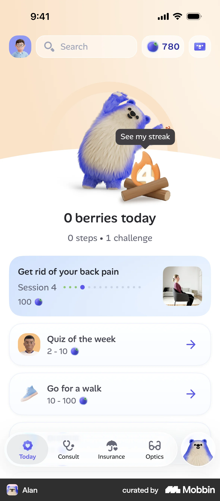
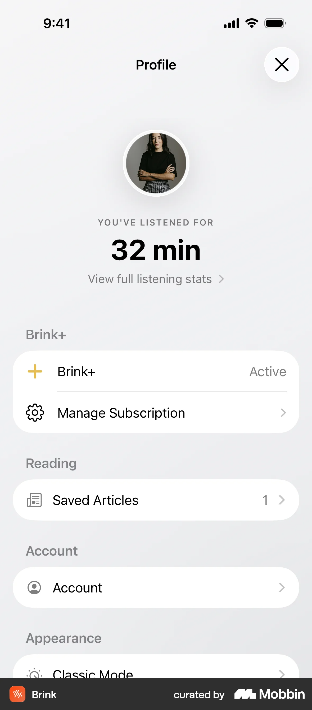

# Redesign references

References support [the product brief](product-brief.md). They provide specific inspiration, not whole-app templates. User preferences below are distinct from unapproved implementation ideas.

## HOME-01 — Alan Home

**Source:** User-supplied screenshot, labeled Alan and curated by Mobbin. No source URL supplied.  
**Recorded:** October 14, 2026  
**Use:** Home composition, hierarchy, navigation presentation, and intentional color.

### What the user likes

- The overall composition and vertical layout feel attractive and understandable.
- The bottom navigation sections feel aligned with Primary Gouge's navigation needs.
- The streak and today's activity are front and center.
- Vertically stacked tiles could represent recently studied materials, with the last studied item highlighted first.
- Color works with the product's character and gives the screen personality.

### Ideas to explore in Primary Gouge

- A prominent greeting, streak, and daily study activity area.
- One highlighted last-studied destination followed by quieter recent-material tiles.
- A related bottom navigation treatment using Primary Gouge's existing destinations.
- Variation between open page sections, a highlighted tile, and supporting tiles instead of repeated nested cards.

These ideas are preferences for exploration, not approved layouts or new runtime features. The daily activity measure remains undecided: possible candidates include flashcards reviewed, discussion items reviewed, or time spent studying. Any choice must have a clear definition and useful meaning to students; do not invent values or assume tracking already exists.

### Boundaries

- Alan is one reference, not the sole inspiration or an exact representation of the target app.
- Do not copy its palette, branding, reward currency, content, or navigation destinations by default.
- The user likes the possibility of a learner mascot similar in spirit to Duolingo, but wants to defer it to a future iteration. Do not include mascot development in the current redesign.
- Preserve the product brief's Home requirements, including question of the day and EPs / Limits / N/W/C access, when exploring this composition.

## Account, settings, and subscription references

**Recorded:** October 14, 2026. These references inform round 10; no new direction is approved yet. Exact flow URLs were opened in Mobbin. Selected screens were inspected, not every screen of every flow. Broad search results that did not match the requested Fable/Jomo flow were discarded as reference evidence.

| Reference | Borrow | Boundaries |
| --- | --- | --- |
| [Buddy — Subscribing to Premium](https://mobbin.com/flows/b055c728-1094-44ae-88e2-b861db4a7d03) | Clear trial timeline, billing explanation, prominent action, native Apple confirmation handoff | Do not copy annual pricing, discounts, App Store rating claims, purple branding, or day-five notification promise. The app currently has one monthly product. |
| [Uptime — Onboarding](https://mobbin.com/flows/55190814-bdf4-46ec-954e-66aa1a4cabe2) | Focused prompts and clear next actions | Do not import its lengthy topic questionnaire or unrelated personalization. |
| [Fable — Onboarding](https://mobbin.com/flows/1e799138-ec21-4762-b492-511c7211ed05) | Benefit-led introduction, separated account entry, clear primary action | Keep only existing Apple/email providers; no new social providers or reading-club features. |
| [v0 — Onboarding](https://mobbin.com/flows/853fb86d-3ec7-45f1-b719-eef63a71c610) | Clear authentication and verification hierarchy | Do not reproduce external Vercel authentication or add its providers. |
| [Jomo — Creating an account](https://mobbin.com/flows/3295a2c4-11a2-4c50-961c-84be8269b878) | Simple staged account creation and verification | No mascot or unnecessary progress questionnaire. |
| Brink Profile — user-supplied screenshot | Quiet white grouped settings, clear subscription status and management, separated section headings | No listening statistic, profile photo requirement, or unsupported settings. |

Round 10 compares open, grouped, and color-anchored versions using the same current-app requirements. The subscription trial timeline is illustrative for eligible users; StoreKit must supply actual price and eligibility. A native Apple purchase sheet is represented as a handoff, not recreated as a fake payment interface.

### Local reference images now available

The user added complete reference folders under `Mobbin/`, plus `Copilot iOS 12.png` and `Blinkist iOS 25.png`. Premium 0/1, Copilot, Blinkist, Jomo account 1, and Fable onboarding 4 were inspected directly. Buddy is now the near-exact composition target for Premium, not merely inspiration for a timeline. The user confirms the trial/reminder sequence is intended and configured in Apple; current app reminder delivery remains a native implementation verification item. This supersedes the earlier exclusion of the Day 5 reminder from the proposed flow. Do not invent store ratings, discounts, prices, or additional plans from reference screenshots.

## More integrated banner and membership references

User-supplied Uptime, Brainly, and Jomo screenshots are saved under `references/`. Borrow Uptime's page-integrated colored header, Brainly's gold membership tint, and Jomo's explicit current-plan/status plus Manage action. Do not import their point counters, streak panel, annual billing, messaging, trial dates, or unsupported settings. Use the actual monthly subscription model and sample-state labels in previews.

- [Uptime header](references/uptime-profile-banner.png)
- [Brainly membership tint](references/brainly-membership.png)
- [Jomo plan/status module](references/jomo-membership.png)
